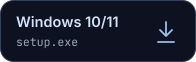
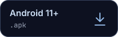
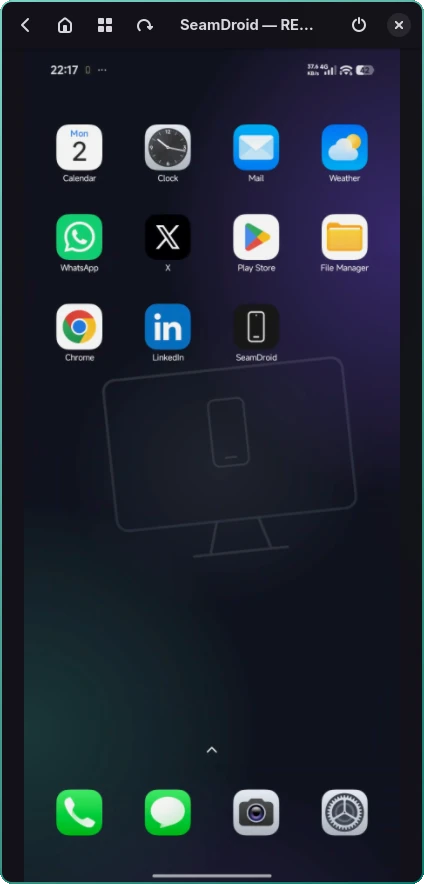
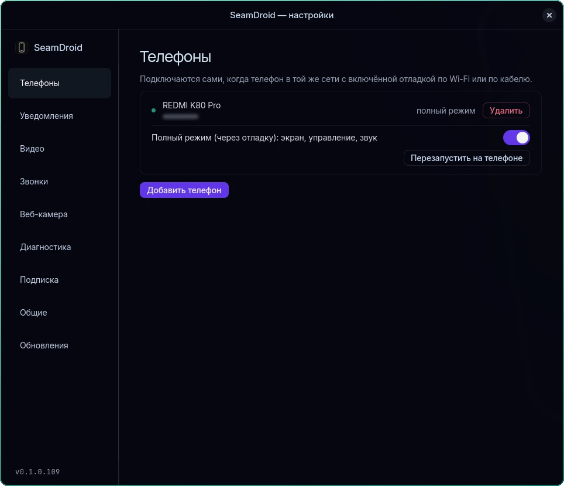
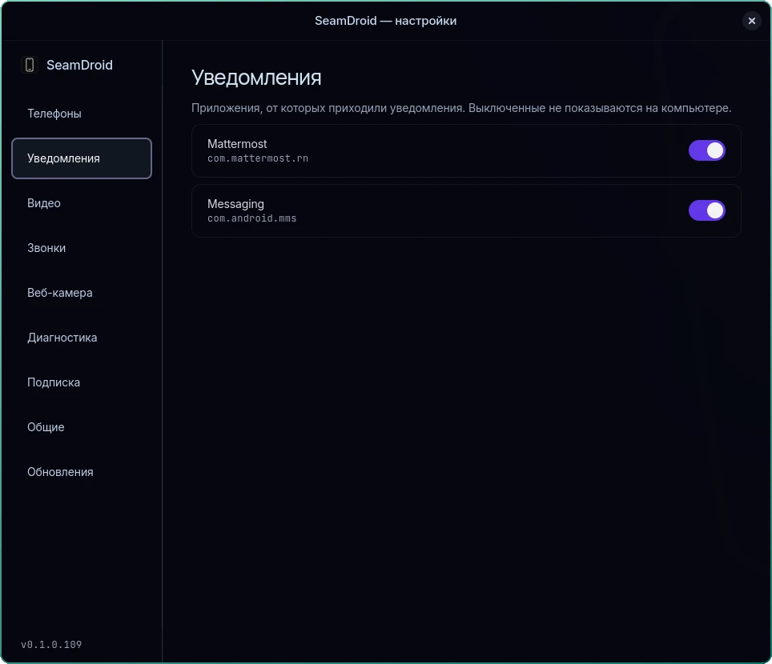
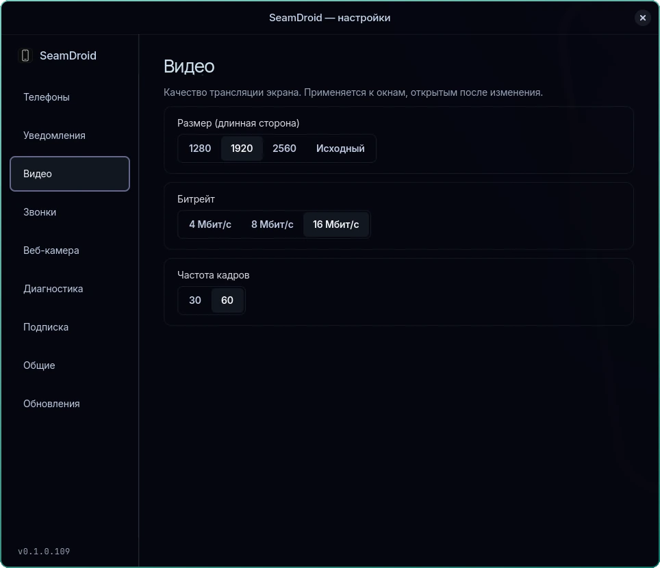
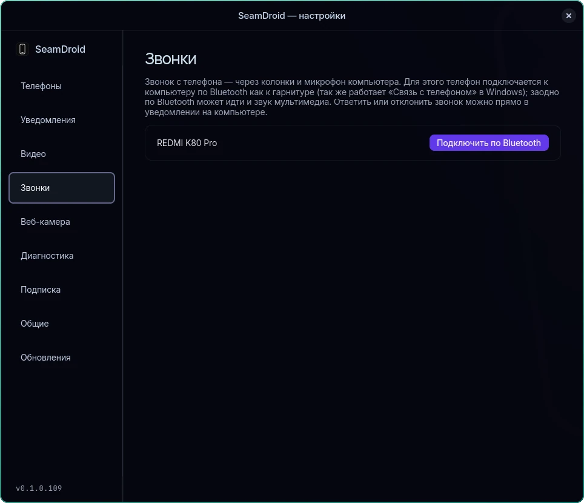
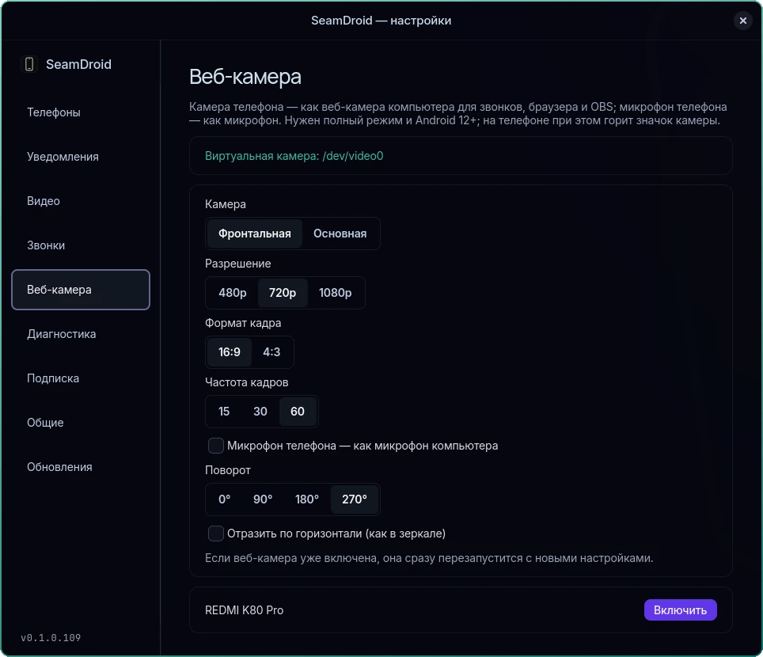
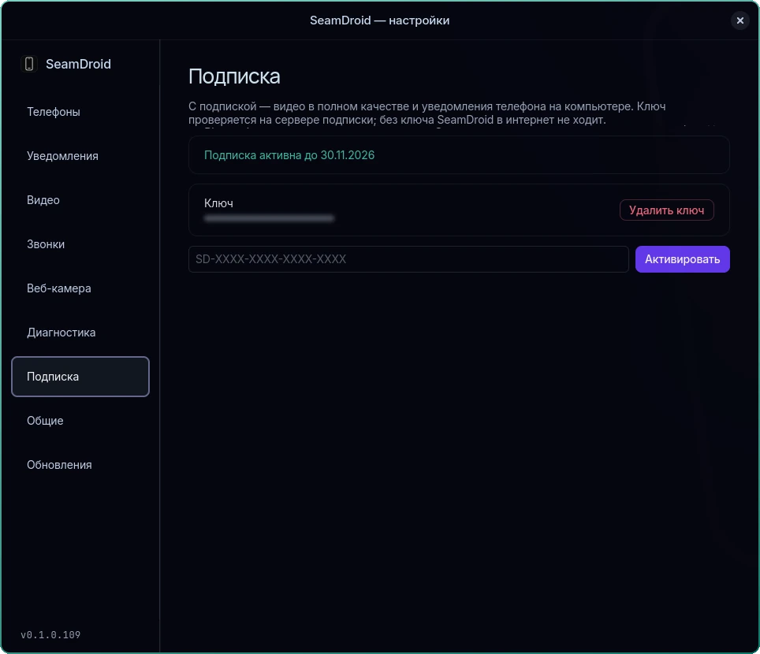

<div align="center">

<a href="https://seamdroid.nicko.space"></a>

<a href="https://seamdroid.nicko.space"></a>

**English** · [Русский](README.ru.md)

</div>

**SeamDroid** shows your Android phone's screen in a window on Linux or Windows and lets you control it with the mouse and keyboard. It also brings notifications, the clipboard, files and audio to the computer, and turns the phone's camera into a webcam. One app, one tray icon, no cloud and no accounts.

## Download

<a href="https://seamdroid.nicko.space/packages/seamdroid-x86_64.pkg.tar.zst"></a>
<a href="https://seamdroid.nicko.space/packages/seamdroid-x86_64.rpm"></a>
<a href="https://seamdroid.nicko.space/packages/seamdroid-setup-x86_64.exe"></a>
<a href="https://seamdroid.nicko.space/packages/seamdroid-android.apk"></a>

Also: [portable Windows zip](https://seamdroid.nicko.space/packages/seamdroid-windows-x86_64.zip) · [SHA-256 checksums](https://seamdroid.nicko.space/packages/SHA256SUMS) · [what's new](https://seamdroid.nicko.space/changelog/)

<details>
<summary><b>Install on Arch or Fedora</b></summary>
<br>

```sh
# Arch
sudo pacman -U ./seamdroid-*.pkg.tar.zst

# Fedora
sudo dnf install ./seamdroid-*.rpm

# Start now and at every login
systemctl --user enable --now seamdroid
```

Then: tray icon → **Settings** → **Add phone**. Full guide: [setup](https://seamdroid.nicko.space/setup/).

</details>

## What it does

Open any row.

<details>
<summary><b>Phone screen in a window</b></summary>
<br>

H.264 video with mouse and keyboard control. The wheel flicks through TikTok, Reels and Shorts, and a button rotates the screen. Each phone gets its own window.

[Screen mirroring](https://seamdroid.nicko.space/screen-mirroring/) · [Control](https://seamdroid.nicko.space/control/)

</details>

<details>
<summary><b>Notifications on the desktop</b></summary>
<br>

Regular desktop notifications with the phone's action buttons and quick reply. You can mute them app by app.

[Notifications](https://seamdroid.nicko.space/notifications/)

</details>

<details>
<summary><b>Clipboard and files</b></summary>
<br>

One clipboard for the computer and all connected phones, plus file transfer both ways.

[Clipboard and files](https://seamdroid.nicko.space/clipboard/)

</details>

<details>
<summary><b>Phone camera as a webcam</b></summary>
<br>

Works in Zoom, Telegram, Discord, OBS and the browser. 480p to 1080p, up to 60 fps, on Linux and Windows 11. Needs Android 12+.

[Webcam](https://seamdroid.nicko.space/webcam/)

</details>

<details>
<summary><b>Audio and calls</b></summary>
<br>

Phone audio plays on the computer. Calls go over Bluetooth, with the computer acting as a headset.

[Audio](https://seamdroid.nicko.space/audio/) · [Calls](https://seamdroid.nicko.space/calls/)

</details>

<details>
<summary><b>Find my phone</b></summary>
<br>

The phone rings at full volume for 30 seconds, even on silent, until you tap "Found".

[Find my phone](https://seamdroid.nicko.space/find-phone/)

</details>

## Screenshots

The app on Linux, in the Russian interface; it also speaks English.

<details open>
<summary><b>Phone window</b></summary>
<br>



</details>

<details>
<summary><b>Phones</b></summary>
<br>



</details>

<details>
<summary><b>Notifications</b></summary>
<br>



</details>

<details>
<summary><b>Video</b></summary>
<br>



</details>

<details>
<summary><b>Calls</b></summary>
<br>



</details>

<details>
<summary><b>Webcam</b></summary>
<br>



</details>

<details>
<summary><b>Subscription</b></summary>
<br>



</details>

## Two modes, no switching

The computer checks which connections to the phone are alive and turns on what is available.

| | Basic (app only) | Full (with ADB) |
|---|---|---|
| Notifications, replies | ✅ | ✅ |
| Clipboard, computer → phone | ✅ | ✅ |
| Clipboard, phone → computer | on action (tile, Share) | ✅ automatic |
| Files, find my phone | ✅ | ✅ |
| Screen, control, audio, webcam | — | ✅ |

## Free and subscription

The free version has no time limit. A subscription removes the limits: [current prices](https://seamdroid.nicko.space/#pricing).

| | Free | Subscription |
|---|---|---|
| Screen | up to 30 fps, 2 Mbit/s, 1280 px | full quality |
| Webcam | up to 720p, 30 fps | up to 1080p, 60 fps |
| Notifications on the computer | — | ✅ |

## Questions

<details>
<summary><b>Does my data go through a cloud?</b></summary>
<br>

No. The phone and computer talk directly, over USB or your network. The app goes online only to check for updates (this can be turned off) and to check a subscription key, if you entered one.

</details>

<details>
<summary><b>Do I need developer mode?</b></summary>
<br>

Only for the screen, control, audio and webcam. Notifications, files and the clipboard need just the companion app.

</details>

<details>
<summary><b>Can I connect several phones?</b></summary>
<br>

Yes. Each phone has its own window, and they all share one clipboard.

</details>

<details>
<summary><b>Where is the source code?</b></summary>
<br>

Not in this repository: it is the project's public page. Downloads are on the [official site](https://seamdroid.nicko.space).

</details>

## Contact

Questions, bugs and ideas: [@seamdroid_bot](https://t.me/seamdroid_bot) on Telegram. Site: [seamdroid.nicko.space](https://seamdroid.nicko.space).

<sub>The phone-side server follows the design of [scrcpy](https://github.com/Genymobile/scrcpy) (Apache-2.0).</sub>
