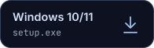
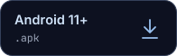

<div align="center">

<a href="https://seamdroid.nicko.space/ru/"></a>

<a href="https://seamdroid.nicko.space/ru/"></a>

[English](README.md) · **Русский**

</div>

**SeamDroid** показывает экран Android-смартфона в окне на Linux или Windows, и телефоном можно управлять мышью и клавиатурой. На компьютер приходят уведомления, буфер обмена, файлы и звук, а камера телефона работает как веб-камера. Одно приложение, один значок в трее, без облака и аккаунтов.

## Скачать

<a href="https://seamdroid.nicko.space/packages/seamdroid-x86_64.pkg.tar.zst"></a>
<a href="https://seamdroid.nicko.space/packages/seamdroid-x86_64.rpm"></a>
<a href="https://seamdroid.nicko.space/packages/seamdroid-setup-x86_64.exe"></a>
<a href="https://seamdroid.nicko.space/packages/seamdroid-android.apk"></a>

Ещё: [портативный zip для Windows](https://seamdroid.nicko.space/packages/seamdroid-windows-x86_64.zip) · [контрольные суммы SHA-256](https://seamdroid.nicko.space/packages/SHA256SUMS) · [что нового](https://seamdroid.nicko.space/ru/changelog/)

<details>
<summary><b>Установка на Arch и Fedora</b></summary>
<br>

```sh
# Arch
sudo pacman -U ./seamdroid-*.pkg.tar.zst

# Fedora
sudo dnf install ./seamdroid-*.rpm

# Запуск сейчас и при каждом входе
systemctl --user enable --now seamdroid
```

Дальше: значок в трее → **Настройки** → **Добавить телефон**. Подробно: [настройка](https://seamdroid.nicko.space/ru/setup/).

</details>

## Что умеет

Раскройте любую строку.

<details>
<summary><b>Экран телефона в окне</b></summary>
<br>

Видео H.264 с управлением мышью и клавиатурой. Колесо листает TikTok, Reels и Shorts, поворот экрана — кнопкой. У каждого телефона своё окно.

[Трансляция экрана](https://seamdroid.nicko.space/ru/screen-mirroring/) · [Управление](https://seamdroid.nicko.space/ru/control/)

</details>

<details>
<summary><b>Уведомления на рабочем столе</b></summary>
<br>

Обычные уведомления рабочего стола с кнопками действий и быстрым ответом. Их можно отключать для отдельных приложений.

[Уведомления](https://seamdroid.nicko.space/ru/notifications/)

</details>

<details>
<summary><b>Буфер обмена и файлы</b></summary>
<br>

Один буфер обмена на компьютер и все подключённые телефоны, плюс передача файлов в обе стороны.

[Буфер обмена и файлы](https://seamdroid.nicko.space/ru/clipboard/)

</details>

<details>
<summary><b>Камера телефона как веб-камера</b></summary>
<br>

Работает в Zoom, Telegram, Discord, OBS и браузере. От 480p до 1080p, до 60 кадров/с, на Linux и Windows 11. Нужен Android 12+.

[Веб-камера](https://seamdroid.nicko.space/ru/webcam/)

</details>

<details>
<summary><b>Звук и звонки</b></summary>
<br>

Звук телефона играет на компьютере. Звонки идут через Bluetooth: компьютер работает как гарнитура.

[Звук](https://seamdroid.nicko.space/ru/audio/) · [Звонки](https://seamdroid.nicko.space/ru/calls/)

</details>

<details>
<summary><b>Поиск телефона</b></summary>
<br>

Телефон 30 секунд звонит на полной громкости, даже в беззвучном режиме, пока не нажмёте «Нашёл».

[Поиск телефона](https://seamdroid.nicko.space/ru/find-phone/)

</details>

## Два режима, переключать не нужно

Компьютер смотрит, какие каналы до телефона сейчас живы, и включает то, что доступно.

| | Базовый (только приложение) | Полный (с ADB) |
|---|---|---|
| Уведомления, ответы | ✅ | ✅ |
| Буфер, компьютер → телефон | ✅ | ✅ |
| Буфер, телефон → компьютер | по действию (плитка, «Поделиться») | ✅ автоматически |
| Файлы, поиск телефона | ✅ | ✅ |
| Экран, управление, звук, веб-камера | — | ✅ |

## Бесплатно и по подписке

Бесплатная версия не ограничена по времени. Подписка снимает ограничения: [актуальные цены](https://seamdroid.nicko.space/ru/#pricing).

| | Бесплатно | Подписка |
|---|---|---|
| Экран | до 30 кадров/с, 2 Мбит/с, 1280 px | полное качество |
| Веб-камера | до 720p, 30 кадров/с | до 1080p, 60 кадров/с |
| Уведомления на компьютере | — | ✅ |

## Вопросы

<details>
<summary><b>Данные идут через облако?</b></summary>
<br>

Нет. Телефон и компьютер общаются напрямую: по USB или через вашу сеть. В интернет приложение выходит, только чтобы проверить обновления (это можно отключить) и ключ подписки, если вы его ввели.

</details>

<details>
<summary><b>Нужен режим разработчика?</b></summary>
<br>

Только для экрана, управления, звука и веб-камеры. Уведомлениям, файлам и буферу обмена хватит приложения на телефоне.

</details>

<details>
<summary><b>Можно подключить несколько телефонов?</b></summary>
<br>

Да. У каждого телефона своё окно, а буфер обмена один на всех.

</details>

<details>
<summary><b>Где исходный код?</b></summary>
<br>

Не в этом репозитории: это публичная страница проекта. Скачать приложение можно на [официальном сайте](https://seamdroid.nicko.space/ru/).

</details>

## Контакты

Вопросы, баги и идеи: Telegram-бот [@seamdroid_bot](https://t.me/seamdroid_bot). Сайт: [seamdroid.nicko.space](https://seamdroid.nicko.space/ru/).

<sub>Серверная часть на телефоне повторяет устройство [scrcpy](https://github.com/Genymobile/scrcpy) (Apache-2.0).</sub>
